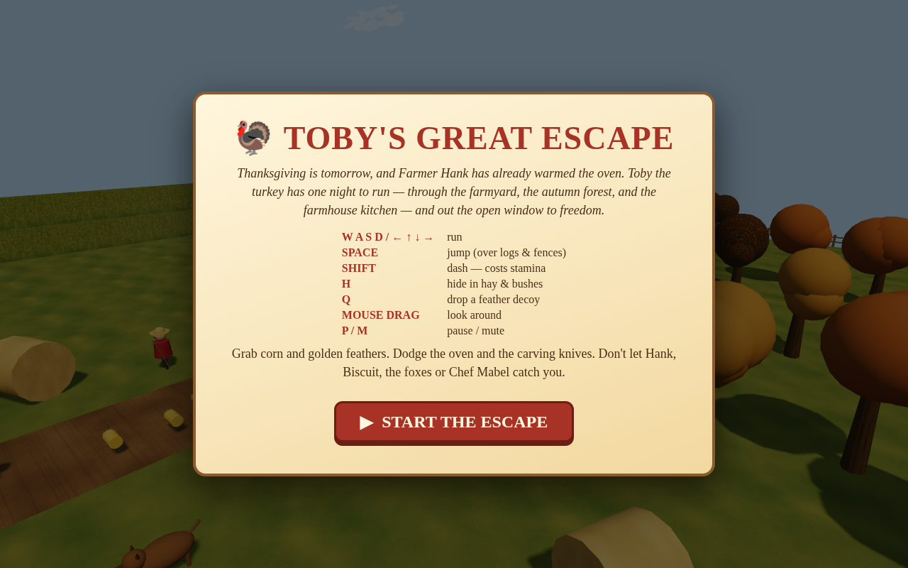
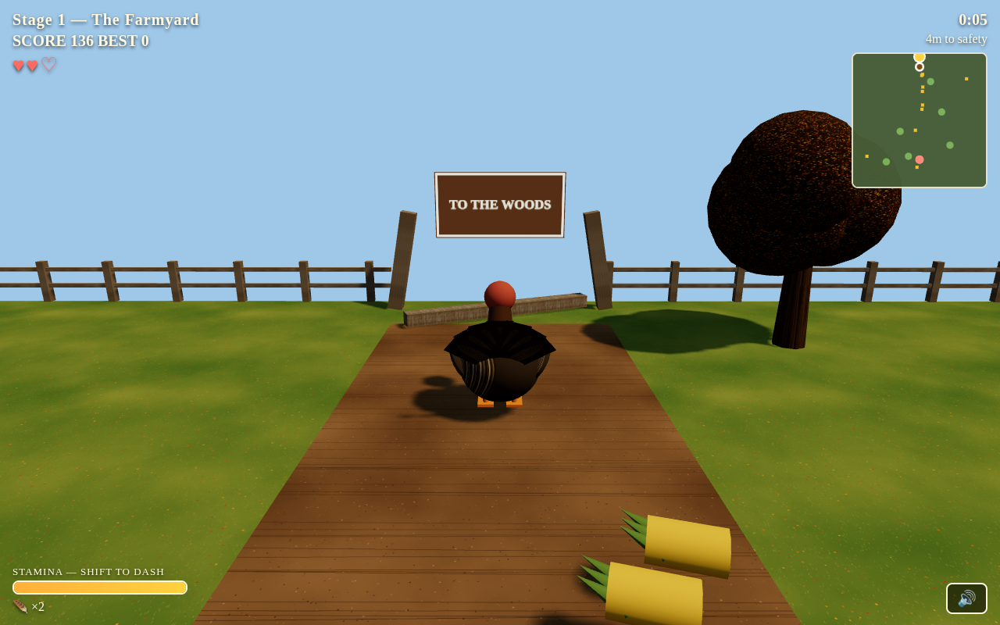
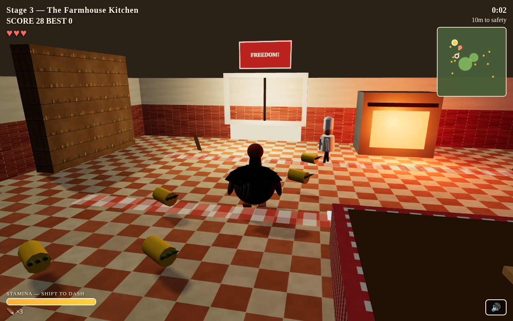
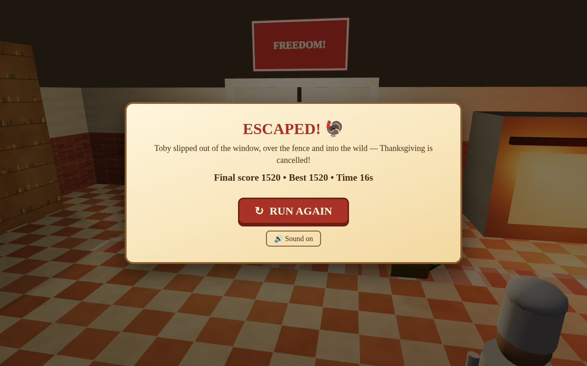

# Toby's Great Escape — a 3D turkey escape game

[](https://make.fun/bounty/turkey-run-game-01?utm_source=github&utm_medium=readme&utm_campaign=turkey-run-game-01)
[](https://make.fun/bounty/turkey-run-game-01/leaderboard?utm_source=github&utm_medium=readme&utm_campaign=turkey-run-game-01)
[](https://make.fun/bounty/turkey-run-game-01?utm_source=github&utm_medium=readme&utm_campaign=turkey-run-game-01)
[](https://github.com/wantakimax6/turkey-run-game)
[](LICENSE)

**Toby's Great Escape** is a real-3D turkey escape game built with Three.js for the
[make.fun bounty **turkey-run-game-01**](https://make.fun/bounty/turkey-run-game-01)
("Make the best turkey escape game"). It runs entirely offline from static
files: the Three.js library is vendored in `game/vendor/three.module.min.js`,
every texture is self-made (see `tools/gen_textures.py`), every sound is
synthesised live with WebAudio, and the game makes no network requests.

## The story

Thanksgiving is tomorrow, and Farmer Hank has already warmed the oven.
**Toby the turkey** has one night to run — through the farmyard, the autumn
forest, and the farmhouse kitchen — and out the open window to freedom.

## Characters

- **Toby** — the turkey. Round, brown, brave, with a fan of real feathers.
- **Farmer Hank** — pitchfork, straw hat, moustache. He wants Toby for dinner.
- **Biscuit** — the farm dog. Faster than Toby. Barks at everything.
- **Rusty (and friends)** — foxes in the autumn forest, with big bushy tails.
- **Chef Mabel** — tall white hat, carving knife held high. She guards the window.

## The three stages

1. **The Farmyard** — escape the barn, dodge Farmer Hank and Biscuit, hide
   behind hay bales, and slip through the broken fence gate.
2. **The Autumn Forest** — foxes hunt these woods. Crouch in the bushes,
   jump the fallen logs, wade the stream, reach the old oak hollow.
3. **The Farmhouse Kitchen** — the oven burns, carving knives slide across
   the floor on striped lanes, and Chef Mabel guards the open window.

## How to play

| Key | Action |
| --- | --- |
| W A S D / arrows | run |
| SPACE | jump (over logs and low fences) |
| SHIFT | dash — costs stamina |
| H | hide in hay and bushes |
| Q | drop a feather decoy (chasers chase the fake Toby) |
| Mouse drag | look around |
| P | pause |
| M | mute |

Grab corn (+10) and golden feathers (+50). Three hearts; a caught turkey
loses one and is knocked back. Reach the exit of each stage to move on —
reach the kitchen window and Toby is free.

## What is in this repo

- `main.ts` — the program that hands the game in: it checks the entry
  against the bounty caps, copies `game/` and `screenshots/` to `/output`,
  and writes `/output/dossier.json`.
- `game/` — the playable game as static files: `index.html` plus ES
  modules under `src/` (world, chasers, HUD, audio, screenshots), the
  vendored Three.js build under `vendor/`, and 24 self-made PNG textures
  under `assets/`.
- `screenshots/` — four real renders of the game's own code: the title
  screen, a farmyard run in play, the kitchen run, and the escape.
- `tools/` — `gen_textures.py` (the texture generator) and `cdp_test.mjs`
  (the headless-Chrome driver that took the screenshots and proved a full
  escape with an autopilot).
- `vendor/makefun-game.ts` — the kit's library, unchanged.

## Play it

```sh
node serve.ts   # then open http://localhost:8080
```

Or serve `game/` with any static server and open `index.html`. Keyboard and
mouse, desktop Chrome. No network needed once the files are on disk.

## Screenshots





